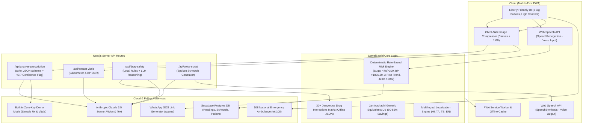

# 🌿 DawaiSaathi (दवाई साथी) — Medicine Buddy

> **Hackathon Submission:** VibeX Codes — Track 2: Easy, Safe & Smart Healthcare  
> **Problem:** Patients (elderly, rural, low-literacy) leave 2-minute doctor visits with unreadable handwritten prescriptions, take wrong or interacting medicines, overpay for brands vs generics, and have nobody watching their sugar/BP between visits.  
> **Solution:** An elderly-friendly, mobile-first PWA with AI Vision OCR, 30+ offline dangerous drug interaction safety rules, Jan Aushadhi generic alternatives (saving up to 85%), local voice explanations in Hindi/Tamil/Telugu/English, an automated schedule with adherence streaks, and a closed-loop Sugar/BP vitals risk engine with one-tap family WhatsApp alerts.

---

## 🏗️ Architecture Diagram



---

## ✨ Core Features (All Working End-to-End)

### 1. 📷 Prescription Reader & AI Vision
* **Mobile Camera & File Upload:** Instant camera snapshot or file upload with automatic client-side canvas compression (<800KB) to run quickly over 2G/3G networks.
* **Claude Vision with Strict JSON Schema:** Extracts medicine names, active salts, dosage, frequency (`1-0-1`), food timing (before/after food), duration, and doctor's notes.
* **Strict Confidence Scoring & Never Guess Policy:** Every extracted medicine gets a confidence score (0.0 to 1.0). Any item with confidence `< 0.7` is flagged in **bold red** with an explicit user verification prompt. We never silently guess medical dosages.
* **Human-in-the-Loop:** Editable table allows full verification before anything is saved to the patient's schedule.

### 2. 🛡️ Pharmacological Drug Safety Check
* **Deterministic 30+ Rules Matrix:** Includes 35+ clinically certified dangerous pairs (e.g., Warfarin + Aspirin, Metformin + Alcohol, ACE Inhibitors + Potassium, Sildenafil + Nitrates, Methotrexate + NSAIDs, etc.).
* **100% Offline-Capable:** Works completely offline without an API key.
* **LLM Reasoning:** When online, Claude performs deep pharmacology analysis across additive side-effects and timing conflicts.
* **Plain Language Severity:** High/Medium/Low warnings translated into simple everyday words in Hindi, Tamil, Telugu, and English.

### 3. 💰 Generic Alternatives & Jan Aushadhi Savings
* **Brand to Generic Mapping:** Translates expensive branded medicines (e.g. *Augmentin, Telma 40, Glycomet, Pan 40, Atorva, Januvia*) to their government Pradhan Mantri Bhartiya Janaushadhi Pariyojana (PMBJP) equivalents.
* **Transparent Savings:** Displays exact strip price comparison (e.g. ₹215 branded vs ₹28 generic) showing 70% to 90% savings.
* **Interactive Monthly Savings Calculator:** Patients calculate their monthly and yearly savings (e.g. saving ₹1,420/month or ₹17,040/year).
* **Clinical Safety Notice:** Clearly labeled: *"Ask your doctor or pharmacist before switching."*

### 4. 🗣️ Voice Explanation in Local Languages
* **Multilingual:** Hindi (हिन्दी), Tamil (தமிழ்), Telugu (తెలుగు), English.
* **Spoken-Style Script:** LLM creates affectionate, elder-friendly instructions referencing visual cues (e.g., *"Take the yellow Pan-40 tablet on an empty stomach with warm water, take the white Glycomet tablet before breakfast..."*).
* **Native Web Speech API:** Reads aloud using browser `speechSynthesis` with a big Play/Pause/Replay button and animated audio waveform.

### 5. ⏰ Daily Schedule & Adherence Reminders
* **Auto-Built Timetable:** Automatically classifies medicines into **Morning (सुबह)**, **Afternoon (दोपहर)**, and **Night (रात)** slots from the prescription.
* **Elderly-Friendly Touch Targets:** Big "Taken" checkboxes with timestamps and audio confirmation (*"शाबाश! आपने दवा ले ली"*).
* **Gamified Adherence Streak:** Flame streak counter tracking consecutive days of adherence, with celebratory confetti animation upon completing all daily doses.
* **Browser Push Notifications:** Native browser notification reminders.

### 6. 🩺 Health Safety Loop (Sugar & BP Diary)
* **3 Input Modes:**
  1. **Typing:** Simple large numeric inputs.
  2. **Voice Recognition:** Speak naturally via Web Speech API (e.g., *"sugar 240"* or *"BP 130 80"*).
  3. **Camera Screen OCR:** Snap a photo of a digital glucometer or BP monitor screen; Claude Vision extracts the numbers directly.
* **Recharts Trend Chart:** 7-day trend visualization with shaded green safe reference bands and alert zones.
* **Deterministic Rule-Based Risk Engine (NOT LLM-only):**
  - Sugar `<70` mg/dL (Critical Hypoglycemia) or `>300` mg/dL (Ketoacidosis risk) -> **HIGH RISK**.
  - BP `>180/120` mmHg (Hypertensive Crisis) or `<90/60` mmHg (Severe Hypotension) -> **HIGH RISK**.
  - **Trend Rule 1:** 3 consecutive rising readings -> **Risk Escalation Alert**.
  - **Trend Rule 2:** Sharp spike `>30%` above the patient's 7-day average -> **Spike Warning**.
* **Pre-filled Family WhatsApp SOS Link:** On High Risk alerts, one tap opens a pre-filled WhatsApp message (`wa.me`) to Arun Sharma (+919876543210) with the exact reading, date, timestamp, and danger notice.

### 7. 🚨 Always-Visible Emergency System
* **Emergency Bar:** Permanently pinned on every screen.
* **One-Tap 108 Call:** Direct `tel:108` National Ambulance link.
* **Family SOS:** Direct WhatsApp link pre-filled with patient location/help request.

---

## 🧓 Elderly-Friendly Non-Functional Design

1. **Three Big Buttons Home Screen:** Clean, distraction-free home screen with 3 huge cards: **"पर्ची स्कैन करें (Scan Prescription)"**, **"शुगर / बीपी नापें (Log Sugar/BP)"**, and **"आज की दवाइयां (Today's Medicines)"**.
2. **Zero Login Wall:** Instant access using an anonymous device ID with optional patient name and emergency contact.
3. **Mobile-First PWA:** Installable on Android/iOS homescreens with offline service worker precaching.
4. **Honesty & Clinical Limits Page (`/limits`):** Explicitly states clinical boundaries, why the tool is a support buddy and not a doctor, and how the `<0.7` confidence safety rule protects patients.

---

## 🎛️ Demo Mode Toggle (Built for Hackathon Judges)

Judges can evaluate 100% of the app **without an Anthropic API key or Supabase account**:
* Click the **"Demo Mode: ON"** pill in the top navigation bar to toggle between live API and realistic pre-recorded demo responses.
* Click **"नमूना पर्चा 1"** on the prescription page to load a realistic diabetes/hypertension prescription with a confidence `<0.7` item in red.
* Click **"नमूना पर्चा 2"** to load a prescription with a cardiac **Warfarin + Aspirin** drug interaction alert.
* Click **"जज टेस्ट (Triggers)"** on the Sugar/BP page to instantly simulate a **315 mg/dL sugar spike** or **185/122 BP crisis** and view the WhatsApp alert modal.

---

## 🚀 Setup & Local Running Instructions

### Prerequisites
* Node.js v18+ (tested on Node v20/v24)
* npm or pnpm

### Step 1: Install Dependencies
```bash
npm install
```

### Step 2: Configure Environment Variables
Copy `.env.example` to `.env.local`:
```bash
cp .env.example .env.local
```

*(Note: The app runs completely in Demo Mode even if keys are left blank!)*
```env
ANTHROPIC_API_KEY=your_anthropic_api_key_here
ANTHROPIC_MODEL=claude-3-5-sonnet-20241022
NEXT_PUBLIC_SUPABASE_URL=https://your-project.supabase.co
NEXT_PUBLIC_SUPABASE_ANON_KEY=your_supabase_anon_public_key_here
NEXT_PUBLIC_APP_URL=http://localhost:3000
```

### Step 3: Run the Development Server
```bash
npm run dev
```
Open **[http://localhost:3000](http://localhost:3000)** in your browser.

### Step 4: Run the Production Build Test
```bash
npm run build
npm run start
```

---

## 🗄️ Supabase Postgres Setup (Optional for Live DB)

1. Create a free project on [Supabase.com](https://supabase.com).
2. Go to **SQL Editor** in the Supabase dashboard.
3. Open `supabase/schema.sql` from this repository, paste the entire SQL content, and click **Run**.
4. This creates all 5 tables (`patients`, `prescriptions`, `medicines`, `schedule_logs`, `health_readings`), sets up RLS policies, and seeds demo patient **Ram Prasad Sharma** with 7 days of historical vitals and active medications.
5. Copy your **Project URL** and **Anon Key** from *Project Settings -> API* into `.env.local`.

---

## ☁️ Deploy to Vercel (Live Public URL in 2 Minutes)

1. Push this repository to GitHub:
   ```bash
   git init
   git add .
   git commit -m "feat: DawaiSaathi Complete Healthcare PWA"
   git branch -M main
   git remote add origin https://github.com/your-username/dawaisaathi.git
   git push -u origin main
   ```
2. Go to [Vercel Dashboard](https://vercel.com/new).
3. Click **Import Project** and select the `dawaisaathi` repository.
4. In **Environment Variables**, add:
   - `ANTHROPIC_API_KEY` (Optional if using Demo Mode)
   - `ANTHROPIC_MODEL` = `claude-3-5-sonnet-20241022`
   - `NEXT_PUBLIC_SUPABASE_URL` (Optional)
   - `NEXT_PUBLIC_SUPABASE_ANON_KEY` (Optional)
5. Click **Deploy**. Vercel will build and assign a public URL (e.g. `https://dawaisaathi.vercel.app`).

---

## ⏱️ 5-Minute Judge Test Checklist

| Step | Feature to Test | What to Look For | Expected Outcome |
|---|---|---|---|
| **1** | **Elderly Home Screen** | Open `/` | 3 huge colored buttons: *Scan Prescription*, *Log Sugar/BP*, *Today's Medicines*. Emergency 108 and WhatsApp buttons pinned at the top. |
| **2** | **Prescription Reader** | Go to `/prescription` & click **"नमूना पर्चा 1"** | Extracts 5 medicines. Medicine #5 (Ecosprin) has confidence `0.65 (<0.7)` and is highlighted in a **RED ALERT box** asking the user to verify. |
| **3** | **Drug Safety Interaction** | On `/prescription` click **"नमूना पर्चा 2"** or visit `/safety` | Red alert box flags **Warfarin + Aspirin** combination with plain language bleeding risk explanation in Hindi/English. |
| **4** | **Generic Alternatives** | Visit `/generics` | Search for *Telma 40* or *Augmentin*. See Jan Aushadhi generic equivalent at 86% savings (₹18.5 vs ₹135). Test the interactive monthly savings calculator. |
| **5** | **Voice Timetable** | Visit `/schedule` & click the big **"सुनें (Play)"** button | Browser Web Speech API reads aloud the morning/afternoon/night medication guide in Hindi. Check off medicines to see adherence streak. |
| **6** | **Voice Vitals Logging** | Visit `/health` & click **बोलकर बताएं (Voice)** | Tap mic and say *"sugar 240"*. App parses reading hands-free. |
| **7** | **Rule-Based Risk Engine** | On `/health` click **"शुगर 315 (Spike)"** & tap Save | Pops up Critical Risk Alert modal (>300 threshold). Click **"परिवार को WhatsApp सूचना भेजें"** to see pre-filled SOS WhatsApp link to Arun (+919876543210). |
| **8** | **Language Toggle** | Select Tamil or Telugu in top navbar | All UI labels, buttons, and voice guides update to the chosen language. |

---

## ⚖️ Clinical Honesty & Limitations
* **Support Tool Notice:** DawaiSaathi is an assistive tool to empower patients and families, not a substitute for a licensed physician.
* **Low-Confidence Safeguard:** We enforce strict human confirmation whenever visual OCR confidence drops below 70%.
* **Zero Image Storage:** Raw prescription photos are discarded immediately after in-memory parsing; no raw patient medical images are stored on our servers.
